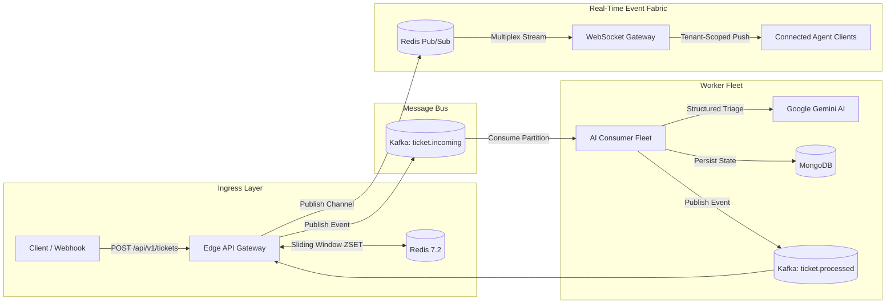

<div align="center">

# FluxDesk

**Real-Time Customer Support Ingestion & AI Triage Engine**


</div>

**FluxDesk** is a high-throughput, multi-tenant backend engine that connects incoming customer support requests to internal support teams. It acts as an intelligent shock absorber: it absorbs ticket bursts instantly, uses background AI workers to analyze urgency and draft responses against company runbooks, and streams live updates directly to support agents' screens without page refreshes.

---

## The Problem: Why Traditional Systems Crash

In standard web applications, when a customer submits a ticket, the API server handles everything in a single synchronous HTTP request—running validation, calling an AI model, saving to the database, and returning a response. Under production load, this architecture fails:

1. **The AI Latency Bottleneck (504 Timeouts):** Large Language Models (LLMs) take 2 to 5 seconds to generate an inference. If an outage or flash sale triggers 500 simultaneous tickets, server connection pools lock up, HTTP connections time out, and users receive `504 Gateway Timeout` errors.
2. **The "Noisy Neighbor" Problem:** In multi-tenant SaaS platforms where multiple organizations share infrastructure, if one bursty customer floods the API with automated requests, they monopolize server threads and starve paying enterprise clients.
3. **Stale Agent Dashboards:** Without real-time event streaming, human support agents are forced to constantly refresh their browsers every 30 seconds to catch high-urgency incidents.
4. **Cross-Tenant Data Leakage:** In naive real-time systems, an improperly scoped event broadcast can leak Company A's sensitive customer tickets into Company B's browser session.

---

## The Solution: How FluxDesk Solves It

FluxDesk decouples high-speed request intake from background AI reasoning using an event-driven distributed architecture:

1. **Sub-25ms Ingestion (Kafka Decoupling):** The Edge Gateway validates incoming tickets, checks rate limits, and immediately drops the ticket onto **Apache Kafka**, returning `202 Accepted` to the customer in `<25ms`. Customers and webhooks never hang waiting for AI processing.
2. **Sliding-Window Rate Limiting (Redis ZSET):** Enforces microsecond-accurate request quotas per organization tier (Enterprise: 60/min, Pro: 30/min, Free: 5/min) to isolate burst spikes and completely eliminate noisy-neighbor starvation.
3. **Asynchronous AI Triage (Worker Pool):** Background workers consume tickets from Kafka partitions, cross-reference internal company runbook documentation, and use LLM APIs to classify urgency (P0 to P3), categorize the issue, and generate grounded draft replies.
4. **Zero-Leakage Real-Time Streaming (WebSockets + Redis Pub/Sub):** As soon as a ticket is ingested or triaged, Redis Pub/Sub multiplexes the event directly to that specific tenant's authenticated **WebSocket room** in `<20ms`, updating the agent's screen live with guaranteed 0% cross-tenant data leakage.

---

## Tech Stack

| Layer | Technology |
| :--- | :--- |
| Runtime | Node.js 18+ |
| Message bus | Apache Kafka (KRaft mode) |
| Cache, rate limiting, Pub/Sub | Redis 7.2 |
| Persistence | MongoDB |
| AI inference | Google Gemini |
| Real-time transport | WebSocket |
| Local infrastructure | Docker Compose |

---

## System Architecture



---

## Design Principles

### Low-latency stream ingestion

The Edge Gateway validates the payload, authenticates the tenant, checks the Redis rate quota, and publishes an event to the `ticket.incoming` Kafka topic before returning `202 Accepted`. Target response time is under 25 ms.

### Sliding-window rate limiting

Quotas are enforced per tenant using Redis sorted sets keyed by `ratelimit:{tenantId}:{endpoint}`. Entries older than 60 seconds are purged on each request.

| Tier | Limit |
| :--- | :--- |
| Enterprise | 60 requests per minute |
| Pro | 30 requests per minute |
| Free | 5 requests per minute |

If Redis becomes unavailable, the rate limiter fails open to preserve intake availability.

### Asynchronous AI triage and grounding

Workers consume Kafka partitions keyed by `tenantId`. Each worker loads the tenant's runbooks from MongoDB, queries Gemini with a structured JSON schema, assigns urgency (`P0_CRITICAL` through `P3_LOW`) and a category, and drafts a suggested reply that cites matched runbooks.

- Confidence of 95% or higher on a standard resolution sets the status to `READY_FOR_APPROVAL`.
- Lower confidence, or any case requiring manual intervention, sets the status to `NEEDS_REVIEW`.

### Tenant-isolated real-time streaming

Redis Pub/Sub channels are scoped per tenant (`tenant:{tenantId}`). The WebSocket Gateway keeps authenticated connections in dedicated per-tenant sets, so agents receive only the events for their own organization.

---

## Industry Reference Implementations

The architectural pattern implemented by FluxDesk—decoupled message queues for burst absorption, in-memory sliding-window rate limiting, asynchronous worker processing, and scoped real-time push—is the standard design pattern adopted by high-scale production systems:

| Company | Architectural Match | Production Use Case |
| :--- | :--- | :--- |
| **Zendesk & Intercom** | Asynchronous ticket queuing + Background AI triage + WebSocket agent streaming | Ingests millions of support requests instantaneously; offloads AI classification and sentiment analysis to background workers before streaming live updates to agent browser sessions. |
| **Shopify** | Kafka event shock absorber + Asynchronous worker fleets + Real-time merchant telemetry | Absorbs massive order and webhook traffic spikes during flash sales and Black Friday without blocking checkout HTTP requests or exhausting databases. |
| **Stripe** | Sub-millisecond HTTP acceptance + Redis sliding-window rate limiting + Asynchronous event pipelines | Protects downstream APIs from burst traffic, isolates noisy tenants with microsecond-accurate rate limiters, and guarantees reliable event ingestion. |
| **Uber** | Edge gateway + Partition-keyed Kafka logs + Asynchronous business logic + Real-time socket dispatch | Partitions incoming ride events and support issues by entity ID to guarantee strict chronological event ordering while eliminating race conditions. |
| **Discord** | Edge WebSocket gateway + Redis state tracking + Scoped channel multiplexing | Manages millions of concurrent WebSocket connections, using isolated room multiplexing to stream real-time events with guaranteed zero cross-tenant data leakage. |

---

## Event Lifecycle

1. **Ingest.** `POST /api/v1/tickets` is validated and rate limited. A `TICKET_SUBMITTED` event is produced to Kafka, keyed by `tenantId`, and the client receives `202 Accepted`.
2. **Stream.** The Gateway emits `TICKET_INGESTED` to connected agent WebSockets through Redis Pub/Sub so queues update immediately.
3. **Process.** Workers consume the event, retrieve tenant runbooks, query Gemini, and persist the result to MongoDB.
4. **Publish.** The worker emits a completion event to the `ticket.processed` topic.
5. **Push.** The Gateway consumes the processed event, broadcasts it through Redis Pub/Sub, and delivers `TICKET_PROCESSED` to authenticated agent sessions.

---

## Getting Started

### Prerequisites

- Node.js 18 or higher
- Docker and Docker Compose
- A Google Gemini API key

### 1. Start infrastructure

Start Apache Kafka (KRaft mode), Redis, and MongoDB:

```bash
docker compose up -d
```

Verify that all services are ready:

```bash
node scripts/verify-infra.js
```

### 2. Configure the environment

```bash
cp .env.example .env
```

Set your Gemini API key in `.env`:

```env
GEMINI_API_KEY=your_gemini_api_key_here
```

### 3. Seed the database

Create the initial tenants, API keys, rate limit tiers, and agent accounts:

```bash
npm run seed
```

This provisions the following pre-configured development credentials:

#### Tenant API keys

Used by client applications and webhooks via the `x-api-key` header or WebSocket connection query:

| Organization | Tenant ID | Plan | Rate limit | API key |
| :--- | :--- | :--- | :--- | :--- |
| Acme Corporation | `org_acme_corp` | Enterprise | 60 req/min | `flx_live_acme_98f12a34` |
| Stripe Alpha Payments | `org_stripe_alpha` | Pro | 30 req/min | `flx_live_stripe_77b31c99` |
| Free Dev Sandbox | `org_free_tier` | Free | 5 req/min | `flx_live_free_11a22b33` |

#### Agent login credentials

Used to authenticate support agents at `POST /api/v1/auth/login`:

| Organization | Role | Email | Password |
| :--- | :--- | :--- | :--- |
| Acme Corporation | `ADMIN` | `sarah@acme.com` | `password123` |
| Stripe Alpha Payments | `AGENT` | `alex@stripe.com` | `password123` |
| Free Dev Sandbox | `AGENT` | `tester@sandbox.com` | `password123` |

### 4. Run the services

Start the Edge Gateway and WebSocket server:

```bash
npm run dev:server
```

In a separate terminal, start the AI worker fleet:

```bash
npm run dev:worker
```

| Service | Address |
| :--- | :--- |
| HTTP API | `http://localhost:4000` |
| WebSocket Gateway | `ws://localhost:4000/ws` |
| Worker health and metrics | `http://localhost:4001` |

---

## Configuration

Configuration is read from environment variables. A template is provided in `.env.example`.

| Variable | Required | Description |
| :--- | :--- | :--- |
| `GEMINI_API_KEY` | Yes | API key used by workers for Google Gemini inference |

Refer to `.env.example` for the full list of supported variables.

---

## API Reference

### Authentication

| Method | Used by | Mechanism |
| :--- | :--- | :--- |
| API key | Tenant clients and webhooks | `x-api-key` header |
| JWT | Support agents | `Authorization: Bearer <token>` header |

### 1. Ingestion and client APIs

#### `POST /api/v1/tickets`

Accepts a support request, verifies the rate quota, and queues the event on Kafka.

**Headers**

| Header | Value |
| :--- | :--- |
| `Content-Type` | `application/json` |
| `x-api-key` | Tenant API key, for example `flx_live_stripe_77b31c99` |

**Request body**

```json
{
  "title": "Payment gateway timeout on checkout",
  "description": "Customers are encountering 504 Gateway Timeout when submitting credit card payments.",
  "customer": {
    "name": "Jane Doe",
    "email": "jane@example.com"
  },
  "channel": "API",
  "metadata": {
    "environment": "production",
    "region": "eu-central-1"
  }
}
```

**Responses**

`202 Accepted`

```json
{
  "success": true,
  "ticketId": "tkt_MVC6LPWXJBYD",
  "status": "QUEUED",
  "tenantId": "org_stripe_alpha",
  "message": "Ticket accepted and queued for processing",
  "latencyMs": 18
}
```

`429 Too Many Requests`

```json
{
  "error": "Too Many Requests",
  "message": "Tenant sliding-window rate limit exceeded. Please wait before submitting more requests.",
  "tenantId": "org_free_tier",
  "limit": 5,
  "windowSeconds": 60,
  "retryAfterSeconds": 24
}
```

`401 Unauthorized`: the API key is missing or invalid.

**Example**

```bash
curl -X POST http://localhost:4000/api/v1/tickets \
  -H "Content-Type: application/json" \
  -H "x-api-key: flx_live_stripe_77b31c99" \
  -d '{
    "title": "Webhook signature verification error",
    "description": "HMAC verification failing after SDK v4.2 update.",
    "customer": { "name": "Alex Smith", "email": "alex@company.com" },
    "channel": "API"
  }'
```

#### `GET /api/v1/tickets/:id`

Returns the current state, AI triage details, and draft response for a ticket.

**Headers:** `x-api-key`

**Response `200 OK`**

```json
{
  "success": true,
  "ticket": {
    "ticketId": "tkt_MVC6LPWXJBYD",
    "tenantId": "org_stripe_alpha",
    "title": "Payment gateway timeout on checkout",
    "status": "READY_FOR_APPROVAL",
    "urgency": "P1_HIGH",
    "category": "Technical Bug",
    "aiDraft": {
      "confidenceScore": 0.96,
      "reasoning": "Standard webhook raw body parsing conflict documented in runbooks.",
      "referencedDocs": ["Webhook Signature Verification"],
      "suggestedReply": "Ensure raw request buffers are preserved prior to JSON parsing middleware."
    },
    "createdAt": "2026-10-18T12:00:00.000Z"
  }
}
```

#### `GET /api/v1/tenants/quota`

Returns current sliding-window consumption and remaining capacity for the authenticated tenant.

**Headers:** `x-api-key`

**Response `200 OK`**

```json
{
  "success": true,
  "tenantId": "org_stripe_alpha",
  "plan": "PRO",
  "rateLimitPerMinute": 30,
  "currentUsage": 4,
  "remainingRequests": 26,
  "windowSizeSeconds": 60
}
```

### 2. Support agent and workspace APIs

#### `POST /api/v1/auth/login`

Authenticates a support agent and returns a tenant-scoped JWT.

**Request body**

```json
{
  "email": "sarah@acme.com",
  "password": "password123"
}
```

**Response `200 OK`**

```json
{
  "success": true,
  "token": "eyJhbGciOiJIUzI1NiIsInR5cCI6IkpXVCJ9...",
  "user": {
    "id": "6ad33cc384e1500d21c46d50",
    "name": "Sarah Connor",
    "email": "sarah@acme.com",
    "role": "ADMIN",
    "tenantId": "org_acme_corp"
  }
}
```

The credentials above are seed data for local development only.

#### `GET /api/v1/tickets`

Returns a tenant-isolated ticket queue with pagination, filtering, and urgency sorting.

**Headers:** `Authorization: Bearer <jwt_token>` or `x-api-key`

**Query parameters**

| Parameter | Description | Default |
| :--- | :--- | :--- |
| `status` | One of `QUEUED`, `PROCESSING`, `NEEDS_REVIEW`, `READY_FOR_APPROVAL`, `RESOLVED`, `CLOSED` | none |
| `urgency` | One of `P0_CRITICAL`, `P1_HIGH`, `P2_MEDIUM`, `P3_LOW` | none |
| `page` | Page index | `1` |
| `limit` | Page size, maximum `100` | `20` |

**Example**

```
GET /api/v1/tickets?status=READY_FOR_APPROVAL&urgency=P1_HIGH&page=1&limit=20
```

#### `PATCH /api/v1/tickets/:id`

Allows an agent to review an AI draft, apply modifications, or resolve a ticket.

**Headers:** `Content-Type: application/json`, `Authorization: Bearer <jwt_token>`

**Request body**

```json
{
  "status": "RESOLVED",
  "humanReview": {
    "finalReply": "The webhook issue was identified as a raw body parser conflict and is now resolved."
  }
}
```

### 3. Real-time WebSocket protocol

**Endpoint:** `ws://localhost:4000/ws`

Connections authenticate with either an API key or a JWT in the query string:

```
ws://localhost:4000/ws?apiKey=<api_key>
ws://localhost:4000/ws?token=<jwt_token>
```

#### Event frames

| Event | Dispatched when |
| :--- | :--- |
| `TICKET_INGESTED` | The HTTP request is accepted |
| `TICKET_PROCESSED` | Worker AI triage completes |
| `TICKET_UPDATED` | A human review or state change occurs |

`TICKET_INGESTED`

```json
{
  "eventId": "evt_1729000000000_a1b2c3d4",
  "type": "TICKET_INGESTED",
  "tenantId": "org_stripe_alpha",
  "timestamp": "2026-10-18T12:00:00.000Z",
  "data": {
    "ticketId": "tkt_MVC6LPWXJBYD",
    "title": "Payment gateway timeout on checkout",
    "status": "QUEUED",
    "urgency": "UNASSIGNED"
  }
}
```

`TICKET_PROCESSED`

```json
{
  "eventId": "evt_27b0829b-3058-4e76-870f-5637215043a6",
  "type": "TICKET_PROCESSED",
  "tenantId": "org_stripe_alpha",
  "timestamp": "2026-10-18T12:00:03.200Z",
  "data": {
    "ticketId": "tkt_MVC6LPWXJBYD",
    "status": "READY_FOR_APPROVAL",
    "urgency": "P1_HIGH",
    "category": "Technical Bug",
    "confidenceScore": 0.96,
    "suggestedReply": "Ensure raw request buffers are preserved prior to JSON parsing middleware."
  }
}
```

### 4. Infrastructure and observability APIs

#### `GET /health`

Runs active checks against MongoDB, Redis, the Kafka producer and consumer, and the WebSocket registry.

**Response `200 OK`**

```json
{
  "status": "UP",
  "timestamp": "2026-10-18T12:00:00.000Z",
  "uptimeSeconds": 312.4,
  "services": {
    "mongodb": { "status": "UP", "state": "connected", "database": "fluxdesk" },
    "redis": { "status": "UP", "latencyMs": 2 },
    "kafka": { "status": "UP", "circuitBreaker": "CLOSED", "connected": true },
    "websocket": { "status": "UP", "activeConnections": 2, "activeTenantsCount": 1 },
    "redisPubSub": { "status": "UP", "pattern": "tenant:*" },
    "kafkaProcessedConsumer": { "status": "UP", "topic": "ticket.processed", "isRunning": true }
  }
}
```

#### `GET /api/v1/realtime/stats`

Returns active WebSocket connections, tenant distribution, and consumer group activity.

**Headers:** `Authorization: Bearer <jwt_token>` or `x-api-key`

---

## Testing

Run the automated verification suite:

```bash
npm test
```

| Stage | Verifies |
| :--- | :--- |
| Tenant isolation | No cross-tenant data leakage across concurrent WebSocket connections |
| Rate limit throttling | Sliding-window enforcement and HTTP 429 backoff calculation |
| Kafka decoupling | Ingestion latency under 25 ms while workers run in the background |
| AI triage validation | Structured schema compliance, grounding accuracy, and confidence threshold behavior |
| WebSocket loop | Ping/pong heartbeats and frame delivery across tenant rooms |

---

## Observability

| Component | Endpoint | Purpose |
| :--- | :--- | :--- |
| Gateway health | `http://localhost:4000/health` | Subsystem status and connection availability |
| Real-time telemetry | `http://localhost:4000/api/v1/realtime/stats` | Active sockets, tenant rooms, message throughput |
| Worker metrics | `http://localhost:4001/metrics` | Consumer throughput, Gemini latency, queue lag |
| Kafka UI | `http://localhost:8080/` | Topic partitions, consumer offsets, message inspection |
| Redis Commander | `http://localhost:8081/` | Rate limit sorted sets and Pub/Sub channels |

---

## Documentation

Message schemas, partition hashing, backpressure controls, and failure recovery are described in [Architecture RFC-001](docs/system-design-rfc.md).

---

## License

This project is licensed under the [MIT License](LICENSE).
