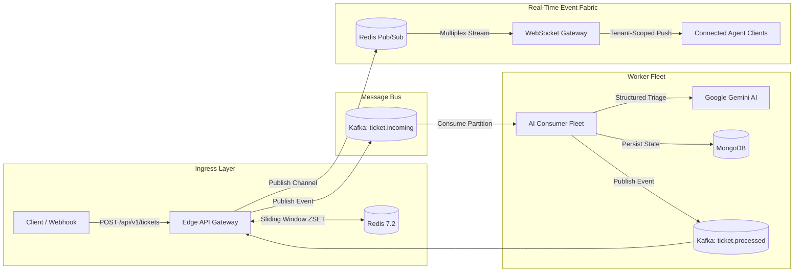

# FluxDesk

> **Distributed Multi-Tenant Real-Time Event Streaming & Ingestion Engine**

FluxDesk is a high-throughput, event-driven infrastructure platform designed to handle bursty ticket ingestion across multiple enterprise tenants. It decouples high-speed request ingestion from latency-heavy background processing using **Apache Kafka**, **Redis**, **Google Gemini**, **MongoDB**, and **WebSockets**.

---

## Architecture Highlights

* **Sub-25ms Ingestion Latency:** Edge API Gateway validates tenant credentials and produces directly to Apache Kafka partitions, returning HTTP `202 Accepted` immediately without blocking on processing.
* **Distributed Sliding-Window Rate Limiting:** Enforced via Redis Sorted Sets (`ZSET`) per tenant tier (Enterprise, Pro, Free) to isolate burst traffic and prevent noisy-neighbor starvation.
* **Strict Tenant-Scoped Real-Time Fabric:** Multiplexes Redis Pub/Sub channels into tenant-isolated WebSocket rooms (`ws://localhost:4000/ws`), guaranteeing **zero cross-tenant data leakage**.
* **Tenant-Partitioned Kafka Ordering:** Kafka topics are partitioned by `tenantId` to guarantee strictly ordered event processing per organization with at-least-once delivery semantics.
* **Asynchronous AI Worker Fleet:** Decoupled background consumer group performs contextual knowledge-base retrieval and structured Gemini AI triage (`urgency`, `category`, `confidenceScore`, `suggestedReply`).
* **Compound Multi-Tenant Database:** MongoDB schema indexed on compound keys (`tenantId + status + createdAt`) ensuring fast queries and isolated tenant boundaries.

---

## System Architecture



---

## End-to-End Event Lifecycle

1. **Ingest (`POST /api/v1/tickets`)**: Edge Gateway checks Redis sliding-window quota. If within limits, an event is produced to Kafka topic `ticket.incoming` keyed by `tenantId`. Response returned in `<25ms`.
2. **Stream (`TICKET_INGESTED`)**: Gateway broadcasts ingestion confirmation immediately to connected tenant WebSockets.
3. **Process (Worker Fleet)**: Background workers pull from Kafka, ground tickets against tenant runbooks, query Google Gemini for structured triage JSON, and persist to MongoDB.
4. **Publish (`ticket.processed`)**: Workers emit completion events to Kafka.
5. **Real-Time Push (`TICKET_PROCESSED`)**: Gateway consumes processed events, dispatches them through Redis Pub/Sub (`tenant:<tenantId>`), and streams live payload updates to the authenticated tenant's WebSockets.

---

## Quickstart Guide

### 1. Prerequisites
* [Node.js](https://nodejs.org/) (v18+)
* [Docker & Docker Compose](https://www.docker.com/)

### 2. Start Supporting Infrastructure
Spin up Apache Kafka (KRaft), Redis, MongoDB, and UI dashboards:

```bash
docker compose up -d
```

Verify service readiness:
```bash
node scripts/verify-infra.js
```

### 3. Configure Environment
Copy the example environment file and insert your credentials:
```bash
cp .env.example .env
```
Ensure your `GEMINI_API_KEY` is set in `.env` for AI classification.

### 4. Seed Multi-Tenant Organizations
Seeds pre-configured tenants and agents across Enterprise, Pro, and Free tiers:
```bash
npm run seed
```

### 5. Start the Engine

**Terminal 1 — Edge Ingestion Gateway & WebSocket Server:**
```bash
npm run dev:server
# Server running at http://localhost:4000
# WebSocket gateway at ws://localhost:4000/ws
```

**Terminal 2 — Asynchronous AI Worker Fleet:**
```bash
npm run dev:worker
# Worker running at http://localhost:4001
```

---

## Automated Verification & Test Suite

FluxDesk includes a comprehensive end-to-end verification suite that validates the entire distributed pipeline:

```bash
npm test
```

This automated suite verifies:
* **Tenant Isolation:** Establishes concurrent WebSocket connections across multiple organizations and verifies **zero cross-tenant message leakage**.
* **Rate Limiting:** Executes burst requests exceeding tenant tier limits and confirms Redis sliding-window throttling.
* **Kafka Decoupling:** Proves ingestion latency under `<25ms` while background workers process tickets asynchronously.
* **AI Triage & Grounding:** Confirms Gemini structured JSON output and tenant runbook matching.
* **WebSocket Streaming:** Verifies bidirectional heartbeats and real-time `TICKET_INGESTED` and `TICKET_PROCESSED` event frames.

---

## Complete API Reference

FluxDesk exposes three distinct categories of APIs designed for specific integration roles:
1. **[User & Ingestion APIs](#1-user--ingestion-apis-customer--webhook-facing)**: For end-customers, external webhooks, and client apps to submit tickets and check status.
2. **[Support Agent APIs](#2-support-agent-apis-internal-team--copilot-facing)**: For human support agents to authenticate, inspect AI triage, and review queues.
3. **[Real-Time & Infrastructure APIs](#3-real-time--infrastructure-apis-event-fabric--observability)**: For WebSocket streaming, telemetry, and service health checks.

---

### 1. User & Ingestion APIs (Customer / Webhook Facing)

These endpoints are used by customer-facing frontends, mobile applications, or third-party webhooks (e.g., Stripe, Shopify) to ingest tickets at high throughput and check resolution progress.

#### `POST /api/v1/tickets` — High-Speed Ticket Ingestion Gateway
* **Purpose:** Decouples incoming requests from heavy AI processing. Validates tenant API keys, checks Redis sliding-window quotas, emits the ticket event directly to Apache Kafka partitions, and returns `202 Accepted` in `<25ms`.
* **Method:** `POST`
* **URL:** `http://localhost:4000/api/v1/tickets`
* **Headers:**
  * `Content-Type: application/json`
  * `x-api-key`: Tenant API Key (e.g. `flx_live_stripe_77b31c99`)
* **Request Body:**
  ```json
  {
    "title": "Payment gateway timeout on checkout",
    "description": "Customers are encountering 504 Gateway Timeout when submitting credit card payments on EU store.",
    "customer": {
      "name": "Jane Doe",
      "email": "jane@example.com"
    },
    "channel": "API",
    "metadata": {
      "environment": "production",
      "region": "eu-central-1"
    }
  }
  ```
* **Responses:**
  * **`202 Accepted`** — Successfully accepted and queued:
    ```json
    {
      "success": true,
      "ticketId": "tkt_MVC6LPWXJBYD",
      "status": "QUEUED",
      "tenantId": "org_stripe_alpha",
      "message": "Ticket accepted and queued for processing",
      "latencyMs": 18
    }
    ```
  * **`429 Too Many Requests`** — Tenant rate limit quota exceeded:
    ```json
    {
      "error": "Too Many Requests",
      "message": "Rate limit exceeded for plan PRO. Max 30 requests per minute.",
      "retryAfterSeconds": 24
    }
    ```
  * **`401 Unauthorized`** — Missing or invalid API key.
* **cURL Usage:**
  ```bash
  curl -X POST http://localhost:4000/api/v1/tickets \
    -H "Content-Type: application/json" \
    -H "x-api-key: flx_live_stripe_77b31c99" \
    -d '{
      "title": "Webhook signature verification error",
      "description": "HMAC verification failing after SDK v4.2 update.",
      "customer": { "name": "Alex Smith", "email": "alex@company.com" },
      "channel": "API"
    }'
  ```

---

#### `GET /api/v1/tickets/:id` — Track Ticket Status & Resolution
* **Purpose:** Allows a customer or integration to poll the real-time status and AI resolution of a submitted ticket.
* **Method:** `GET`
* **URL:** `http://localhost:4000/api/v1/tickets/tkt_MVC6LPWXJBYD`
* **Headers:**
  * `x-api-key`: Tenant API Key (e.g. `flx_live_stripe_77b31c99`)
* **Response (`200 OK`):**
  ```json
  {
    "success": true,
    "ticket": {
      "ticketId": "tkt_MVC6LPWXJBYD",
      "tenantId": "org_stripe_alpha",
      "title": "Payment gateway timeout on checkout",
      "status": "NEEDS_REVIEW",
      "urgency": "P1_HIGH",
      "category": "Technical Bug",
      "aiDraft": {
        "confidenceScore": 0.85,
        "reasoning": "User experiencing a 504 gateway timeout during checkout...",
        "referencedDocs": ["Webhook Signature Verification"],
        "suggestedReply": "Hello Jane, please ensure raw request buffers are preserved before JSON parsers mutate headers..."
      },
      "createdAt": "2026-10-17T09:15:47.730Z"
    }
  }
  ```
* **cURL Usage:**
  ```bash
  curl -X GET http://localhost:4000/api/v1/tickets/tkt_MVC6LPWXJBYD \
    -H "x-api-key: flx_live_stripe_77b31c99"
  ```

---

#### `GET /api/v1/tenants/quota` — Check Rate Limit Quota & Remaining Capacity
* **Purpose:** Inquires the tenant's current plan tier, rate limit ceiling, and available request allowance in the active sliding window.
* **Method:** `GET`
* **URL:** `http://localhost:4000/api/v1/tenants/quota`
* **Headers:**
  * `x-api-key`: Tenant API Key (e.g. `flx_live_stripe_77b31c99`)
* **Response (`200 OK`):**
  ```json
  {
    "success": true,
    "tenantId": "org_stripe_alpha",
    "plan": "PRO",
    "rateLimitPerMinute": 30,
    "currentUsage": 4,
    "remainingRequests": 26,
    "windowSizeSeconds": 60
  }
  ```
* **cURL Usage:**
  ```bash
  curl -X GET http://localhost:4000/api/v1/tenants/quota \
    -H "x-api-key: flx_live_stripe_77b31c99"
  ```

---

### 2. Support Agent APIs (Internal Team / Copilot Facing)

These endpoints are used by human support agents, team leads, and admin dashboards to authenticate, monitor tenant-isolated queues, and perform human-in-the-loop review.

#### `POST /api/v1/auth/login` — Support Agent Authentication
* **Purpose:** Authenticates support agents with email and password, issuing a tenant-scoped JWT bearer token.
* **Method:** `POST`
* **URL:** `http://localhost:4000/api/v1/auth/login`
* **Headers:**
  * `Content-Type: application/json`
* **Request Body:**
  ```json
  {
    "email": "sarah@acme.com",
    "password": "password123"
  }
  ```
* **Response (`200 OK`):**
  ```json
  {
    "success": true,
    "token": "eyJhbGciOiJIUzI1NiIsInR5cCI6IkpXVCJ9...",
    "user": {
      "id": "6ad33cc384e1500d21c46d50",
      "name": "Sarah Connor",
      "email": "sarah@acme.com",
      "role": "ADMIN",
      "tenantId": "org_acme_corp"
    }
  }
  ```
* **Pre-Seeded Agent Accounts:**
  * **Acme Enterprise (`ADMIN`):** `sarah@acme.com` / `password123`
  * **Stripe Pro (`AGENT`):** `alex@stripe.com` / `password123`
  * **Free Sandbox (`AGENT`):** `tester@sandbox.com` / `password123`
* **cURL Usage:**
  ```bash
  curl -X POST http://localhost:4000/api/v1/auth/login \
    -H "Content-Type: application/json" \
    -d '{"email": "alex@stripe.com", "password": "password123"}'
  ```

---

#### `GET /api/v1/auth/me` — Current Agent Session Profile
* **Purpose:** Validates the active JWT session and retrieves the authenticated agent's profile, role, and tenant organization.
* **Method:** `GET`
* **URL:** `http://localhost:4000/api/v1/auth/me`
* **Headers:**
  * `Authorization: Bearer <jwt_token>`
* **Response (`200 OK`):**
  ```json
  {
    "success": true,
    "user": {
      "id": "6ad33cc384e1500d21c46d51",
      "name": "Alex Smith",
      "email": "alex@stripe.com",
      "role": "AGENT",
      "tenantId": "org_stripe_alpha"
    }
  }
  ```
* **cURL Usage:**
  ```bash
  curl -X GET http://localhost:4000/api/v1/auth/me \
    -H "Authorization: Bearer <jwt_token>"
  ```

---

#### `GET /api/v1/tickets` — Agent Ticket Queue (Filtered & Paginated)
* **Purpose:** Displays the tenant's ticket queue with strict tenant isolation. Supports pagination and filtering by processing status (`QUEUED`, `TRIAGED`, `NEEDS_REVIEW`, `RESOLVED`) and AI urgency (`P0_CRITICAL`, `P1_HIGH`, `P2_MEDIUM`, `P3_LOW`).
* **Method:** `GET`
* **URL:** `http://localhost:4000/api/v1/tickets?status=NEEDS_REVIEW&urgency=P1_HIGH&page=1&limit=20`
* **Headers:**
  * `Authorization: Bearer <jwt_token>` (or `x-api-key: <api_key>`)
* **Response (`200 OK`):**
  ```json
  {
    "success": true,
    "tickets": [
      {
        "ticketId": "tkt_MVC6LPWXJBYD",
        "title": "Payment gateway timeout on checkout",
        "status": "NEEDS_REVIEW",
        "urgency": "P1_HIGH",
        "category": "Technical Bug",
        "customer": { "name": "Jane Doe", "email": "jane@example.com" },
        "aiDraft": {
          "confidenceScore": 0.85,
          "suggestedReply": "Hello Jane, please ensure raw request buffers are preserved..."
        },
        "createdAt": "2026-10-17T09:15:47.730Z"
      }
    ],
    "pagination": { "page": 1, "limit": 20, "total": 1 }
  }
  ```
* **cURL Usage:**
  ```bash
  curl -X GET "http://localhost:4000/api/v1/tickets?status=NEEDS_REVIEW" \
    -H "Authorization: Bearer <jwt_token>"
  ```

---

#### `PATCH /api/v1/tickets/:id` — Human Review & Ticket Resolution
* **Purpose:** Allows a support agent to edit the AI-generated draft response, approve resolution, or transition ticket state (`IN_PROGRESS`, `RESOLVED`). Emits a `TICKET_UPDATED` event live across all connected tenant WebSockets.
* **Method:** `PATCH`
* **URL:** `http://localhost:4000/api/v1/tickets/tkt_MVC6LPWXJBYD`
* **Headers:**
  * `Content-Type: application/json`
  * `Authorization: Bearer <jwt_token>` (or `x-api-key: <api_key>`)
* **Request Body:**
  ```json
  {
    "status": "RESOLVED",
    "agentReply": "The webhook issue was identified as a raw body parser conflict and is now resolved."
  }
  ```
* **Response (`200 OK`):**
  ```json
  {
    "success": true,
    "ticket": {
      "ticketId": "tkt_MVC6LPWXJBYD",
      "status": "RESOLVED",
      "humanReview": {
        "reviewedBy": "Alex Smith",
        "reviewedAt": "2026-10-17T09:20:00.000Z",
        "finalReply": "The webhook issue was identified as a raw body parser conflict and is now resolved."
      }
    }
  }
  ```
* **cURL Usage:**
  ```bash
  curl -X PATCH http://localhost:4000/api/v1/tickets/tkt_MVC6LPWXJBYD \
    -H "Content-Type: application/json" \
    -H "Authorization: Bearer <jwt_token>" \
    -d '{"status": "RESOLVED", "agentReply": "Resolved after review."}'
  ```

---

#### `GET /api/v1/tenants` — List Tenant Workspaces & Tier Configurations
* **Purpose:** Retrieves registered tenant organizations, their active SLA tiers (`ENTERPRISE`, `PRO`, `FREE`), rate limit ceilings, and grounded runbook documentation.
* **Method:** `GET`
* **URL:** `http://localhost:4000/api/v1/tenants`
* **Headers:** None (Public)
* **Response (`200 OK`):** Array of tenant profiles and policy configurations.
* **cURL Usage:**
  ```bash
  curl -X GET http://localhost:4000/api/v1/tenants
  ```

---

### 3. Real-Time & Infrastructure APIs (Event Fabric & Observability)

These endpoints provide persistent WebSocket event streaming, deep multi-subsystem health checks, and real-time pub/sub telemetry.

#### `ws://localhost:4000/ws` — Real-Time WebSocket Event Stream
* **Purpose:** Persistent bidirectional connection for receiving live ticket events. Ensures **zero cross-tenant data leakage** by multiplexing Redis Pub/Sub directly into tenant-authenticated rooms.
* **Connection URL:**
  ```
  ws://localhost:4000/ws?apiKey=flx_live_stripe_77b31c99
  ```
  *(Or with Agent JWT: `ws://localhost:4000/ws?token=<jwt_token>`)*
* **Event Frames Streamed:**
  * **`TICKET_INGESTED`** (Pushed immediately upon API acceptance):
    ```json
    {
      "eventId": "evt_1729000000000_a1b2c3d4",
      "type": "TICKET_INGESTED",
      "tenantId": "org_stripe_alpha",
      "timestamp": "2026-10-17T09:15:47.730Z",
      "data": {
        "ticketId": "tkt_MVC6LPWXJBYD",
        "title": "Payment gateway timeout on checkout",
        "status": "QUEUED",
        "urgency": "UNASSIGNED"
      }
    }
    ```
  * **`TICKET_PROCESSED`** (Pushed when Gemini AI completes classification):
    ```json
    {
      "eventId": "evt_27b0829b-3058-4e76-870f-5637215043a6",
      "type": "TICKET_PROCESSED",
      "tenantId": "org_stripe_alpha",
      "timestamp": "2026-10-17T09:15:50.933Z",
      "data": {
        "ticketId": "tkt_MVC6LPWXJBYD",
        "status": "NEEDS_REVIEW",
        "urgency": "P1_HIGH",
        "category": "Technical Bug",
        "confidenceScore": 0.85,
        "suggestedReply": "Hello Jane, please ensure raw request buffers are preserved...",
        "processingDurationMs": 2818
      }
    }
    ```
  * **`TICKET_UPDATED`** (Pushed when an agent approves or modifies ticket status).
* **JavaScript / Browser Usage:**
  ```javascript
  const socket = new WebSocket('ws://localhost:4000/ws?apiKey=flx_live_stripe_77b31c99');

  socket.onmessage = (event) => {
    const frame = JSON.parse(event.data);
    console.log(`[${frame.type}] Received:`, frame.data);
  };
  ```

---

#### `GET /health` — Full Infrastructure & Subsystem Health Check
* **Purpose:** Probes all backing services (MongoDB, Redis, Kafka producer, Kafka processed consumer, Redis Pub/Sub, and WebSocket connection pool) for container orchestrators and uptime monitors.
* **Method:** `GET`
* **URL:** `http://localhost:4000/health`
* **Headers:** None (Public)
* **Response (`200 OK`):**
  ```json
  {
    "status": "UP",
    "timestamp": "2026-10-17T09:20:00.000Z",
    "uptimeSeconds": 312.4,
    "services": {
      "mongodb": { "status": "UP", "state": "connected", "database": "fluxdesk" },
      "redis": { "status": "UP", "latencyMs": 2 },
      "kafka": { "status": "UP", "circuitBreaker": "CLOSED", "connected": true },
      "websocket": { "status": "UP", "activeConnections": 2, "activeTenantsCount": 1 },
      "redisPubSub": { "status": "UP", "pattern": "tenant:*" },
      "kafkaProcessedConsumer": { "status": "UP", "topic": "ticket.processed", "isRunning": true }
    }
  }
  ```
* **cURL Usage:**
  ```bash
  curl -X GET http://localhost:4000/health
  ```

---

#### `GET /api/v1/realtime/stats` — Real-Time Telemetry & Socket Metrics
* **Purpose:** Provides operational metrics on active client WebSockets, tenant connection distribution, Redis Pub/Sub throughput, and Kafka consumer group lag.
* **Method:** `GET`
* **URL:** `http://localhost:4000/api/v1/realtime/stats`
* **Headers:**
  * `Authorization: Bearer <jwt_token>` (or `x-api-key: <api_key>`)
* **Response (`200 OK`):**
  ```json
  {
    "success": true,
    "realtime": {
      "websocket": {
        "totalConnections": 14,
        "activeConnections": 3,
        "eventsDispatched": 42,
        "activeTenantsCount": 2,
        "tenantConnections": { "org_stripe_alpha": 2, "org_acme_corp": 1 }
      },
      "pubsub": {
        "messagesPublished": 42,
        "messagesReceived": 42,
        "pattern": "tenant:*"
      },
      "kafkaConsumer": {
        "topic": "ticket.processed",
        "eventsConsumed": 42,
        "isRunning": true
      }
    }
  }
  ```
* **cURL Usage:**
  ```bash
  curl -X GET http://localhost:4000/api/v1/realtime/stats \
    -H "x-api-key: flx_live_stripe_77b31c99"
  ```

---

## Observability & Dashboards

| Service | Port / URL | Description |
| :--- | :--- | :--- |
| **Edge Ingestion API** | `http://localhost:4000/health` | Gateway health & active connection count |
| **Real-Time Telemetry** | `http://localhost:4000/api/v1/realtime/stats` | Active WebSocket rooms, tenants & message counts |
| **Worker Metrics** | `http://localhost:4001/metrics` | Consumer throughput, Gemini latency & queue lag |
| **Kafka UI** | `http://localhost:8080/` | Inspect Kafka topics, consumer groups, partition offsets |
| **Redis Commander** | `http://localhost:8081/` | Inspect sliding-window rate limit ZSETs & Pub/Sub |

---

## Architecture RFC & Documentation
For deep-dive specifications on data contracts, failure modes, partition strategies, and backpressure designs, see:
* [Architecture RFC-001](docs/system-design-rfc.md)
