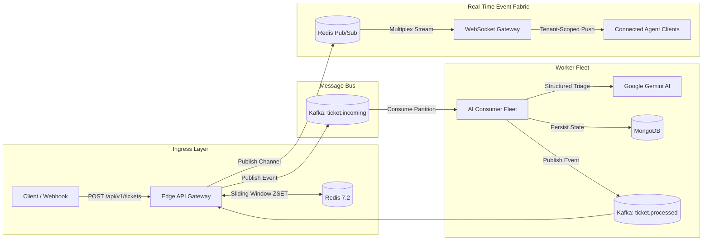

# FluxDesk

> **Distributed Multi-Tenant Real-Time Event Streaming & Ingestion Engine**

FluxDesk is a high-throughput, event-driven infrastructure platform designed to handle bursty ticket ingestion across multiple enterprise tenants. It decouples high-speed request ingestion from latency-heavy background processing using **Apache Kafka**, **Redis**, **Google Gemini**, **MongoDB**, and **WebSockets**.

---

## Architecture Highlights

* **Sub-25ms Ingestion Latency:** Edge API Gateway validates tenant credentials and produces directly to Apache Kafka partitions, returning HTTP `202 Accepted` immediately without blocking on processing.
* **Distributed Sliding-Window Rate Limiting:** Enforced via Redis Sorted Sets (`ZSET`) per tenant tier (Enterprise, Pro, Free) to isolate burst traffic and prevent noisy-neighbor starvation.
* **Strict Tenant-Scoped Real-Time Fabric:** Multiplexes Redis Pub/Sub channels into tenant-isolated WebSocket rooms (`ws://localhost:4000/ws`), guaranteeing **zero cross-tenant data leakage**.
* **Tenant-Partitioned Kafka Ordering:** Kafka topics are partitioned by `tenantId` to guarantee strictly ordered event processing per organization with at-least-once delivery semantics.
* **Asynchronous AI Worker Fleet:** Decoupled background consumer group performs contextual knowledge-base retrieval and structured Gemini AI triage (`urgency`, `category`, `confidenceScore`, `suggestedReply`).
* **Compound Multi-Tenant Database:** MongoDB schema indexed on compound keys (`tenantId + status + createdAt`) ensuring fast queries and isolated tenant boundaries.

---

## System Architecture



---

## End-to-End Event Lifecycle

1. **Ingest (`POST /api/v1/tickets`)**: Edge Gateway checks Redis sliding-window quota. If within limits, an event is produced to Kafka topic `ticket.incoming` keyed by `tenantId`. Response returned in `<25ms`.
2. **Stream (`TICKET_INGESTED`)**: Gateway broadcasts ingestion confirmation immediately to connected tenant WebSockets.
3. **Process (Worker Fleet)**: Background workers pull from Kafka, ground tickets against tenant runbooks, query Google Gemini for structured triage JSON, and persist to MongoDB.
4. **Publish (`ticket.processed`)**: Workers emit completion events to Kafka.
5. **Real-Time Push (`TICKET_PROCESSED`)**: Gateway consumes processed events, dispatches them through Redis Pub/Sub (`tenant:<tenantId>`), and streams live payload updates to the authenticated tenant's WebSockets.

---

## Quickstart Guide

### 1. Prerequisites
* [Node.js](https://nodejs.org/) (v18+)
* [Docker & Docker Compose](https://www.docker.com/)

### 2. Start Supporting Infrastructure
Spin up Apache Kafka (KRaft), Redis, MongoDB, and UI dashboards:

```bash
docker compose up -d
```

Verify service readiness:
```bash
node scripts/verify-infra.js
```

### 3. Configure Environment
Copy the example environment file and insert your credentials:
```bash
cp .env.example .env
```
Ensure your `GEMINI_API_KEY` is set in `.env` for AI classification.

### 4. Seed Multi-Tenant Organizations
Seeds pre-configured tenants across Enterprise, Pro, and Free tiers:
```bash
npm run seed
```

### 5. Start the Engine

**Terminal 1 — Edge Ingestion Gateway & WebSocket Server:**
```bash
npm run dev:server
# Server running at http://localhost:4000
# WebSocket gateway at ws://localhost:4000/ws
```

**Terminal 2 — Asynchronous AI Worker Fleet:**
```bash
npm run dev:worker
# Worker running at http://localhost:4001
```

---

## Automated Verification & Test Suite

FluxDesk includes a comprehensive end-to-end verification suite that validates the entire distributed pipeline:

```bash
npm test
```

This automated suite verifies:
* **Tenant Isolation:** Establishes concurrent WebSocket connections across multiple organizations and verifies **zero cross-tenant message leakage**.
* **Rate Limiting:** Executes burst requests exceeding tenant tier limits and confirms Redis sliding-window throttling.
* **Kafka Decoupling:** Proves ingestion latency under `<25ms` while background workers process tickets asynchronously.
* **AI Triage & Grounding:** Confirms Gemini structured JSON output and tenant runbook matching.
* **WebSocket Streaming:** Verifies bidirectional heartbeats and real-time `TICKET_INGESTED` and `TICKET_PROCESSED` event frames.

---

## REST API Reference

### 1. Ingest Ticket (`POST /api/v1/tickets`)
High-speed edge ingestion gateway. Authenticates tenant credentials, checks the Redis sliding-window quota, emits the ticket event into Apache Kafka, and returns `202 Accepted` in `<25ms`.

* **Method:** `POST`
* **URL:** `http://localhost:4000/api/v1/tickets`
* **Headers:**
  * `Content-Type: application/json`
  * `x-api-key`: Tenant API key (e.g. `flx_live_stripe_77b31c99`)
* **Request Body:**
  ```json
  {
    "title": "Payment gateway timeout on checkout",
    "description": "Customers are encountering 504 Gateway Timeout when submitting credit card payments on EU store.",
    "customer": {
      "name": "Jane Doe",
      "email": "jane@example.com"
    },
    "channel": "API",
    "metadata": {
      "environment": "production",
      "region": "eu-central-1"
    }
  }
  ```

#### Responses:
* **`202 Accepted`** (Ticket successfully accepted and queued):
  ```json
  {
    "success": true,
    "ticketId": "tkt_1729000000000_a1b2c3",
    "status": "QUEUED",
    "tenantId": "org_stripe_alpha",
    "message": "Ticket accepted and queued for processing",
    "latencyMs": 18
  }
  ```
* **`429 Too Many Requests`** (Rate limit quota exceeded for tenant tier):
  ```json
  {
    "error": "Too Many Requests",
    "message": "Rate limit exceeded for plan PRO. Max 30 requests per minute.",
    "retryAfterSeconds": 24
  }
  ```
* **`401 Unauthorized`** (Missing or invalid API key):
  ```json
  {
    "error": "Unauthorized",
    "message": "Valid API key or authorization header is required."
  }
  ```

#### cURL Example:
```bash
curl -X POST http://localhost:4000/api/v1/tickets \
  -H "Content-Type: application/json" \
  -H "x-api-key: flx_live_stripe_77b31c99" \
  -d '{
    "title": "Webhook signature verification error",
    "description": "HMAC verification failing after SDK v4.2 update.",
    "customer": { "name": "Alex Smith", "email": "alex@company.com" },
    "channel": "API"
  }'
```

---

### 2. List Tickets (`GET /api/v1/tickets`)
Fetch paginated tickets for the authenticated tenant with optional status and urgency filters.

* **Method:** `GET`
* **URL:** `http://localhost:4000/api/v1/tickets?status=TRIAGED&urgency=HIGH&page=1&limit=20`
* **Headers:** `x-api-key: flx_live_stripe_77b31c99` (or `Authorization: Bearer <jwt_token>`)
* **Response (`200 OK`):**
  ```json
  {
    "success": true,
    "tickets": [
      {
        "ticketId": "tkt_1729000000000_a1b2c3",
        "status": "TRIAGED",
        "urgency": "HIGH",
        "category": "Billing",
        "confidenceScore": 0.94,
        "suggestedReply": "We have escalated this to our payment integrations team...",
        "createdAt": "2026-10-17T10:00:00.000Z"
      }
    ],
    "pagination": { "page": 1, "limit": 20, "total": 14 }
  }
  ```

---

### 3. Get Ticket Details (`GET /api/v1/tickets/:id`)
Retrieve full ticket details including the AI triage analysis, reasoning, and suggested reply.

* **Method:** `GET`
* **URL:** `http://localhost:4000/api/v1/tickets/tkt_1729000000000_a1b2c3`
* **Headers:** `x-api-key: flx_live_stripe_77b31c99` (or `Authorization: Bearer <jwt_token>`)

---

### 4. Review / Update Ticket (`PATCH /api/v1/tickets/:id`)
Update ticket status or record human agent review. Emits a `TICKET_UPDATED` event live across all tenant WebSocket subscribers.

* **Method:** `PATCH`
* **URL:** `http://localhost:4000/api/v1/tickets/tkt_1729000000000_a1b2c3`
* **Headers:** `x-api-key: flx_live_stripe_77b31c99` (or `Authorization: Bearer <jwt_token>`)
* **Request Body:**
  ```json
  {
    "status": "RESOLVED",
    "agentReply": "The webhook issue was identified as a raw body parser conflict and is now resolved."
  }
  ```

---

## Real-Time WebSocket API Specification

### Connection Endpoint
```
ws://localhost:4000/ws
```

### Authentication Methods
* **Tenant API Key (Query):** `ws://localhost:4000/ws?apiKey=flx_live_stripe_77b31c99`
* **Agent JWT (Query):** `ws://localhost:4000/ws?token=<jwt_token>`
* **HTTP Headers:** `x-api-key`, `Authorization: Bearer <token>`, or `x-tenant-id`

### Event Frame Structure
```json
{
  "eventId": "evt_1729000000000_a1b2c3d4",
  "type": "TICKET_PROCESSED",
  "tenantId": "stripe",
  "timestamp": "2026-10-17T10:00:00.000Z",
  "data": {
    "ticketId": "tkt_99812",
    "status": "TRIAGED",
    "urgency": "HIGH",
    "category": "BILLING",
    "confidenceScore": 0.96,
    "suggestedReply": "We have identified the billing anomaly...",
    "processingDurationMs": 412
  }
}
```

---

## Observability & Dashboards

| Service | Port / URL | Description |
| :--- | :--- | :--- |
| **Edge Ingestion API** | `http://localhost:4000/health` | Gateway health & active connection count |
| **Real-Time Telemetry** | `http://localhost:4000/api/v1/realtime/stats` | Active WebSocket rooms, tenants & message counts |
| **Worker Metrics** | `http://localhost:4001/metrics` | Consumer throughput, Gemini latency & queue lag |
| **Kafka UI** | `http://localhost:8080/` | Inspect Kafka topics, consumer groups, partition offsets |
| **Redis Commander** | `http://localhost:8081/` | Inspect sliding-window rate limit ZSETs & Pub/Sub |

---

## Architecture RFC & Documentation
For deep-dive specifications on data contracts, failure modes, partition strategies, and backpressure designs, see:
* [Architecture RFC-001](docs/system-design-rfc.md)
