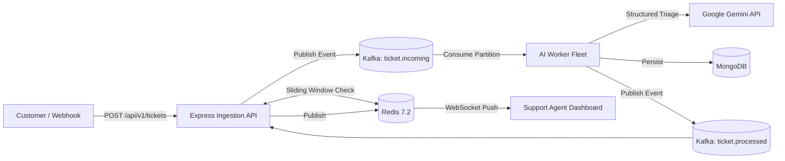

# ⚡ FluxDesk

> **Enterprise-Grade Multi-Tenant Event-Driven Customer Support Intelligence Engine**

FluxDesk is a high-throughput, distributed customer support platform designed to handle bursty ticket ingestion across multiple enterprise tenants. It decouples high-speed request ingestion from latency-heavy generative AI reasoning using **Apache Kafka**, **Redis**, **Google Gemini**, **MongoDB**, and **WebSockets**.

---

## 🎯 Architecture Highlights

* **Sub-25ms Ingestion Latency:** Edge API Gateway immediately validates tenant authorization and pushes tickets into Kafka topics, returning HTTP `202 Accepted` to customers without waiting for AI pipelines.
* **Distributed Sliding-Window Rate Limiting:** Enforced via Redis Sorted Sets (`ZSET`) to isolate tenant burst traffic and prevent noisy-neighbor starvation.
* **Apache Kafka (KRaft mode):** Partitioned strictly by `tenantId` to ensure ordered message processing per organization with at-least-once delivery semantics.
* **Asynchronous AI Worker Fleet:** Independent consumer workers execute knowledge base lookups and query Google Gemini with structured JSON schemas for automated ticket triage and response drafting.
* **Real-Time Agent Updates:** Leverages Redis Pub/Sub multiplexed into tenant-isolated WebSocket channels to push live ticket status updates to human agents instantly.
* **Compound Multi-Tenant Database:** MongoDB schema with compound indexes (`tenantId + status + createdAt`) ensuring zero tenant data cross-talk and millisecond query times.

---

## 🏗️ System Overview

---

## 📋 Engineering Phases

| Phase | Milestone | Description | Status |
| :---: | :--- | :--- | :---: |
| **0** | **System Design & RFC-001** | Architecture specification, data models, event contracts, failure modes | **Complete** ✅ |
| **1** | **Infrastructure Provisioning** | Docker Compose with Kafka (KRaft), Redis, MongoDB, health checks | **Complete** ✅ |
| **2** | **Ingestion API Service** | Express Gateway, Redis sliding-window rate limiter, Kafka producer | **Complete** ✅ |
| **3** | **AI Worker Fleet** | Kafka consumer group, Gemini AI structured triage, MongoDB storage | **Complete** ✅ |
| **4** | **Real-Time Fabric** | Redis Pub/Sub multiplexer & WebSocket gateway | **Complete** ✅ |
| **5** | **Operations Dashboard** | React + Vite + Tailwind agent workspace with real-time updates | Next ⏳ |
| **6** | **Resilience & Production Polish** | DLQ handler, chaos/retry tests, resume metrics & portfolio showcase | Queued ⏳ |

---

## 📖 Specifications

* Detailed Architecture RFC: [docs/system-design-rfc.md](docs/system-design-rfc.md)
