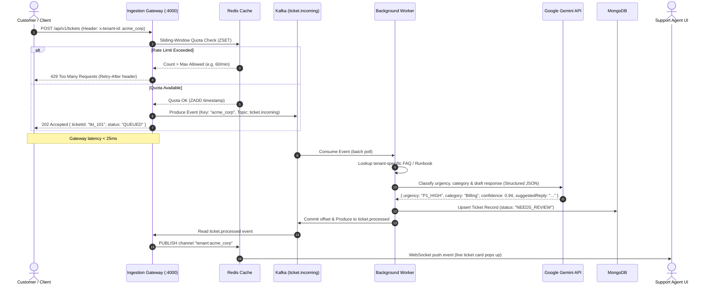

# System Design & Architecture Specification (RFC-001)
## Project: FluxDesk — Multi-Tenant Event-Driven Customer Support Intelligence Engine

---

### 1. Executive Summary & Problem Statement

Modern enterprise customer support platforms (e.g., Zendesk, Intercom, Salesforce Service Cloud) process high-velocity bursts of customer inquiries across hundreds of distinct business organizations (tenants). Synchronous monolithic architectures suffer from severe production bottlenecks:
1. **Request Timeouts & Thread Exhaustion:** Generative AI inference (LLM calls) takes 1.5s–5.0s. Running LLM reasoning directly inside the HTTP request loop blocks server execution threads and creates cascading timeouts under load spikes.
2. **The "Noisy Neighbor" Problem:** A sudden ticket surge from one free or misconfigured tenant exhausts compute capacity and upstream AI rate limits, starving premium paying tenants.
3. **Data Leakage Across Tenants:** Without strict tenant partitioning across caching, queuing, database storage, and real-time streaming, tenant data risks cross-contamination.
4. **Outage Fragility:** Downstream outages (e.g., LLM provider downtime, third-party API latency) cause customer submissions to be dropped if requests are not buffered in an immutable message log.

**FluxDesk Architecture Solution:**
An event-driven microservices architecture built with:
* **Apache Kafka (KRaft mode)** as an immutable, distributed streaming backbone ensuring durable ticket ingestion and at-least-once processing.
* **Redis** for distributed sliding-window multi-tenant rate limiting and real-time Pub/Sub message distribution.
* **Node.js / Express Gateway** achieving sub-25ms ingestion latency by decoupling submission from AI triage.
* **Autonomous Worker Pool** consuming Kafka partitions, executing knowledge-base grounding, and querying Google Gemini API with structured JSON schemas.
* **MongoDB** with compound indexing (`tenantId + status + createdAt`) guaranteeing strict multi-tenant isolation and fast analytical queries.
* **React + WebSockets Dashboard** delivering zero-latency updates to support agents without client polling.

---

### 2. High-Level Architecture Topology

```mermaid
flowchart TD
    subgraph ClientLayer [Client & Ingestion Layer]
        C1["Customer Portal / Webhook"]
        C2["E-Commerce / External Systems"]
        R1["Support Agent UI (React + Tailwind)"]
    end

    subgraph GatewayLayer [Edge API Gateway - Node.js Express :4000]
        GW["API Gateway (Express.js)"]
        AUTH["Tenant Auth & Header Validator"]
        RL["Distributed Sliding-Window Rate Limiter"]
    end

    subgraph CacheBrokerLayer [Streaming & Caching Layer]
        REDIS[("Redis 7.2 (ZSET Rate Limit & Pub/Sub)")]
        K_IN["Kafka Topic: ticket.incoming (Key: tenantId)"]
        K_PROC["Kafka Topic: ticket.processed"]
        K_DLQ["Kafka Topic: ticket.dlq (Dead-Letter Queue)"]
    end

    subgraph WorkerFleet [Asynchronous AI Worker Fleet]
        W1["Worker Node 1 (Consumer Group: fluxdesk-workers)"]
        W2["Worker Node 2 (Consumer Group: fluxdesk-workers)"]
        KB[("Knowledge Base (Tenant Runbooks & FAQ)")]
        GEMINI["Google Gemini API (Structured Output)"]
    end

    subgraph StorageLayer [Persistent Storage]
        MDB[("MongoDB 7.0 (Tickets Collection)")]
    end

    C1 -->|1. POST /api/v1/tickets| GW
    C2 -->|1. POST /api/v1/tickets| GW
    GW --> AUTH
    AUTH --> RL
    RL <-->|2. ZREMRANGEBYSCORE + ZCARD| REDIS
    GW -->|3. Produce Event (Partitioned by tenantId)| K_IN
    GW -.->|4. HTTP 202 Accepted { ticketId, status: QUEUED }| C1

    K_IN -->|5. Batch Poll| W1
    K_IN -->|5. Batch Poll| W2

    W1 -->|6a. Retrieve Tenant Docs| KB
    W1 -->|6b. Structured LLM Triage| GEMINI
    W1 -->|7. Upsert Ticket & Status| MDB
    W1 -->|8. Produce Resolution Event| K_PROC
    W1 -.->|On 3 Failed Retries| K_DLQ

    K_PROC -->|9. Consume Notification| GW
    GW -->|10. Redis PUBLISH tenant:tenantId| REDIS
    REDIS -->|11. WebSocket Broadcast| R1
```

---

### 3. End-to-End Sequence Diagram



---

### 4. Component Technical Specifications & Invariants

#### 4.1. Edge API Gateway (`server/`)
* **Framework:** Express.js with Node.js runtime.
* **Target Latency:** p99 < 25ms.
* **Responsibilities & Authentication Modes:**
  * **External Ingestion Mode:** Validates `x-api-key: flx_live_...` or `x-tenant-id`. Used by company contact forms, query boxes, mobile apps, or webhooks.
  * **Internal Dashboard Mode:** Validates JWT (`Authorization: Bearer <token>`) for registered agents accessing their company's workspace.
  * Input sanitization & validation (title, description, customer email).
  * Enforcing tenant rate quotas using Redis sliding-window algorithm.
  * Producing partition-keyed events to Kafka without blocking on persistence.
  * Exposing WebSocket server (Socket.io / ws) with tenant channel isolation.

#### 4.2. Distributed Sliding-Window Rate Limiter
* **Algorithm:** Redis Sorted Set (`ZSET`).
* **Key Format:** `ratelimit:{tenantId}:{endpoint}`
* **Invariants:**
  1. Window: Sliding 60 seconds (rolling timestamp).
  2. Score & Member: Current timestamp in milliseconds (`Date.now()`).
  3. Atomic pipeline:
     * `ZREMRANGEBYSCORE key 0 (now - 60000)`
     * `ZCARD key`
     * If `cardinality < maxAllowed`: `ZADD key now now` + `EXPIRE key 60`
     * Else: return `429 Too Many Requests` + `X-RateLimit-Reset`.

#### 4.3. Event Messaging Fabric (Apache Kafka KRaft)
* **Mode:** KRaft (Kafka Raft Metadata mode) — zero external Zookeeper dependency.
* **Key Invariant:** Every event produced to `ticket.incoming` MUST set `key: tenantId`. This guarantees that all tickets for a specific tenant are processed in strict order within the same partition, preventing race conditions.
* **Topics Definition:**
  * `ticket.incoming`: Raw validated submissions. Partition count: 3 (allows parallel worker scaling).
  * `ticket.processed`: AI-enriched tickets ready for dispatch and dashboard broadcast.
  * `ticket.dlq`: Dead-letter queue for events failing after 3 exponential backoff attempts.

#### 4.4. Asynchronous AI Worker Fleet (`worker/`)
* **Consumer Group:** `fluxdesk-worker-group`.
* **Execution Pipeline:**
  1. Fetch ticket event from Kafka.
  2. Query in-memory/MongoDB tenant runbook for context injection.
  3. Invoke **Google Gemini API** (`gemini-1.5-flash` / `gemini-2.5-flash`) enforcing schema validation:
     * `urgency`: `P0_CRITICAL` | `P1_HIGH` | `P2_MEDIUM` | `P3_LOW`
     * `category`: `Billing` | `Technical Bug` | `Account Access` | `Feature Request` | `General`
     * `suggestedReply`: Enterprise professional response draft.
     * `confidenceScore`: Float between `0.0` and `1.0`.
     * `canAutoResolve`: Boolean flag (true if confidence > 0.95 and high clarity).
  4. Write ticket to MongoDB.
  5. Commit Kafka offset **only after** MongoDB write succeeds (At-Least-Once Delivery).

#### 4.5. Persistent Storage & Multi-Tenancy (MongoDB)
* **Collection:** `tickets`
* **Compound Indexing:**
  * `{ tenantId: 1, status: 1, createdAt: -1 }` — High-speed dashboard queries.
  * `{ tenantId: 1, urgency: 1 }` — Priority queue sorting.
  * `{ ticketId: 1 }` (unique) — Instant direct lookup.

---

### 5. Data Contracts & Schemas

#### 5.1. Kafka Ingestion Contract: `ticket.incoming`
```json
{
  "specVersion": "1.0",
  "eventId": "evt_98f12a34-78bc-4def-9101-abcdef123456",
  "eventType": "TICKET_SUBMITTED",
  "timestamp": "2026-10-11T11:00:00.000Z",
  "tenantId": "org_stripe_alpha",
  "payload": {
    "ticketId": "tkt_01J9X8R1B5",
    "customer": {
      "name": "Alex Mercer",
      "email": "alex@mercer.dev"
    },
    "title": "Webhook signature verification failing on node cluster",
    "description": "After updating the SDK to v4.2, HMAC-SHA256 signature mismatch occurs on 500 status.",
    "channel": "API",
    "metadata": {
      "ipAddress": "198.51.100.42",
      "userAgent": "curl/7.88.1"
    }
  }
}
```

#### 5.2. Gemini AI Structured Triage Schema
```json
{
  "urgency": "P1_HIGH",
  "category": "Technical Bug",
  "reasoning": "Customer reports production webhook failure impacting payment verifications.",
  "suggestedReply": "Hi Alex,\n\nIn SDK v4.2, the raw webhook payload buffering requirement changed. Please ensure raw request buffers are passed before JSON body parsers execute...\n\nBest,\nSupport Engineering",
  "confidenceScore": 0.93,
  "referencedDocs": [
    "runbook-webhook-signatures.md"
  ],
  "canAutoResolve": false
}
```

#### 5.3. MongoDB Document Schema
```json
{
  "_id": "ObjectId('67090b8f1c8e1a001a123456')",
  "ticketId": "tkt_01J9X8R1B5",
  "tenantId": "org_stripe_alpha",
  "customer": {
    "name": "Alex Mercer",
    "email": "alex@mercer.dev"
  },
  "title": "Webhook signature verification failing on node cluster",
  "description": "After updating the SDK to v4.2...",
  "status": "NEEDS_REVIEW",
  "urgency": "P1_HIGH",
  "category": "Technical Bug",
  "aiDraft": {
    "suggestedReply": "Hi Alex,...",
    "reasoning": "Customer reports production webhook failure...",
    "confidenceScore": 0.93,
    "referencedDocs": ["runbook-webhook-signatures.md"]
  },
  "humanReview": {
    "reviewedBy": null,
    "reviewedAt": null,
    "finalReply": null
  },
  "createdAt": "2026-10-11T11:00:00.000Z",
  "updatedAt": "2026-10-11T11:00:02.450Z"
}
```

#### 5.4. Tenant & User Schema (`tenants` & `users` Collections)
```javascript
// Tenant Organization Model
const TenantSchema = new mongoose.Schema({
  tenantId: { type: String, required: true, unique: true, index: true }, // e.g. "org_acme_corp"
  name: { type: String, required: true },
  apiKey: { type: String, required: true, unique: true, index: true }, // e.g. "flx_live_..."
  plan: { type: String, enum: ["FREE", "PRO", "ENTERPRISE"], default: "PRO" },
  rateLimitPerMinute: { type: Number, default: 60 },
  knowledgeBase: [{
    title: String,
    content: String,
    tags: [String]
  }],
  createdAt: { type: Date, default: Date.now }
});

// Support Agent / User Model
const UserSchema = new mongoose.Schema({
  tenantId: { type: String, required: true, index: true },
  name: { type: String, required: true },
  email: { type: String, required: true, unique: true, index: true },
  passwordHash: { type: String, required: true },
  role: { type: String, enum: ["ADMIN", "AGENT"], default: "AGENT" },
  createdAt: { type: Date, default: Date.now }
});
```

---

### 6. Resilience, Security & SRE Guarantees

| Concern | Architectural Solution |
| :--- | :--- |
| **Kafka Broker Downtime** | Express Gateway maintains a bounded in-memory buffer with circuit breaker; returns `503 Service Unavailable` with `Retry-After` if downstream Kafka is unresponsive, avoiding silent drops. |
| **LLM Provider Outage / 429** | Worker uses exponential backoff with full jitter (1s, 2s, 4s). On 3 successive failures, event routes to `ticket.dlq` without blocking the Kafka consumer offset. |
| **Worker Crash Mid-Processing** | Offset commit is delayed until MongoDB write confirmation. A crashed worker triggers automatic partition rebalancing, and another worker picks up unacknowledged events. |
| **Cross-Tenant Contamination** | Strict tenant scoping enforced across all database queries (`{ tenantId }`), Kafka keys (`tenantId`), and Redis Pub/Sub channels (`tenant:{tenantId}`). |
| **Poison Pill Messages** | Malformed payloads failing JSON schema validation are immediately directed to DLQ and logged with alerts, preventing consumer infinite loops. |

---

### 7. Phased Implementation Roadmap

* **Phase 0 (Current):** RFC-001 System Design Specification & Architecture Invariants.
* **Phase 1:** Local Container Infrastructure (Docker Compose: Kafka KRaft, Redis, MongoDB, health checks, environment templates).
* **Phase 2:** Edge Ingestion API Service (Express.js, Redis sliding-window rate limiter, Kafka producer, tenant auth).
* **Phase 3:** Asynchronous AI Worker Fleet (Kafka consumer, runbook matcher, Google Gemini API structured output, MongoDB persistence).
* **Phase 4:** Real-Time Event Fabric (Redis Pub/Sub, WebSockets streaming to tenant channels).
* **Phase 5:** Operations Dashboard (React + Vite + Tailwind, live queue, AI copilot inspector, multi-tenant switcher).
* **Phase 6:** End-to-End Verification, DLQ Replay Tools & Resume Highlights.
